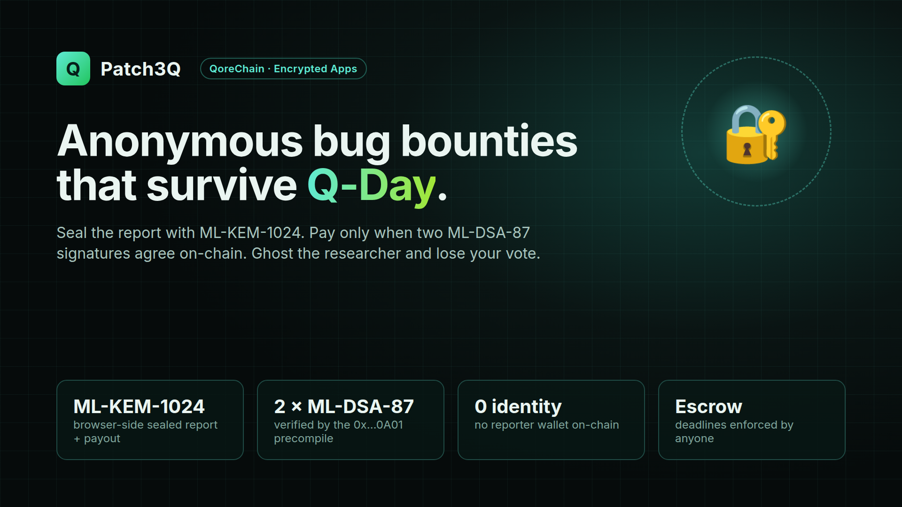
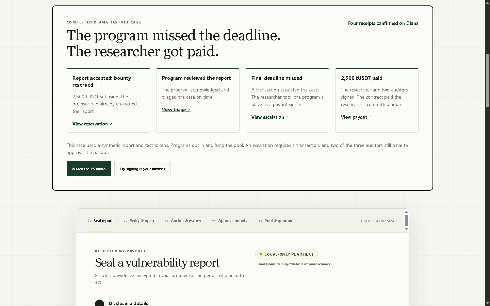
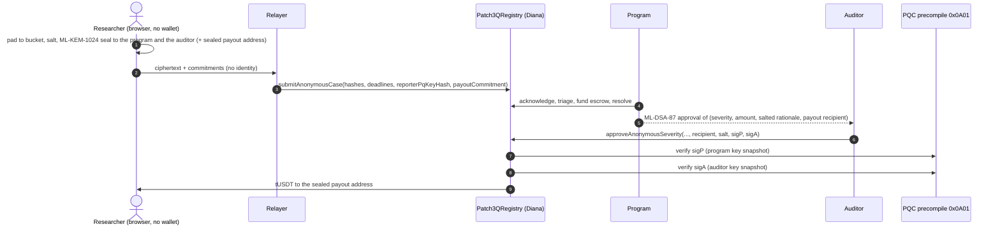
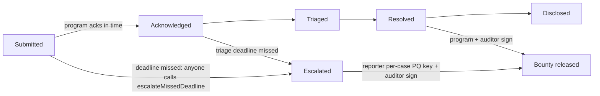

# Patch3Q

**Anonymous bug reports. Bounties reserved upfront. If the program misses a deadline, the researcher takes over its payout vote.**

[](https://github.com/Agozie180/Patch3Q/actions/workflows/ci.yml)
[](https://dashboard.qorechain.io/explorer/address/0xba42c59f3982202dbe2358a0d238de098eaf1ddb)
[](docs/testnet-evidence.md)
[](https://github.com/Agozie180/Patch3Q/actions/runs/45842509500)


[](LICENSE)

[**Open the missed-deadline case**](https://patch3-q.vercel.app/#missed-deadline) · [**Watch the V5 demo**](https://patch3-q.vercel.app/demo-v5.mp4) · [QoreChain project entry](https://build.qorechain.io/p/patch3q)

Build Before Q-Day · Encrypted Apps · [$1,500 first prize and $750 second prize](https://build.qorechain.io/prizes#encrypted_apps)



Patch3Q is a post-quantum bug bounty app for QoreChain. The browser encrypts each report to the participating program and its auditors. An accepted case reserves its bounty from a funded pool. If the program misses a response or final decision deadline, anyone can escalate. The researcher takes the program’s place as a payout signer. Two of three auditors still have to co-sign in the live policy.

## The case to judge

On Diana testnet, a program accepted a synthetic report, reserved **2,500 tUSDT**, and reviewed it on time. Then it missed the final decision deadline. The case escalated, the reporter and two auditors signed, and the contract paid the committed recipient.

| Step | Diana receipt |
| --- | --- |
| Case accepted and 2,500 tUSDT reserved | [Reserve](https://dashboard.qorechain.io/explorer/tx/0x124d9492488506123bfd67fe05cc0143fd79d808a6516b274e8771a196dd20f1) |
| Program triaged on time | [Triage](https://dashboard.qorechain.io/explorer/tx/0x2feffbd3cc5175d9159f547202bf83bd875dc81ca5047c4546709637b349ae50) |
| Final decision deadline passed and the case escalated | [Escalation](https://dashboard.qorechain.io/explorer/tx/0x1fd093ec19d8c1905f7215172f6737ceea14b69bf1f10a3afb1992ec18aeaac7) |
| Researcher and two auditors authorized the payout | [Payout](https://dashboard.qorechain.io/explorer/tx/0x9e48cc90a6585c7759daf6c5ebad2d05f6ffa8e9869ea52464a32146ab5464c2) |

The V5 verifier also replays a late program payout against Diana and checks that the contract returns `DeadlineExpired`. [Recorded check](https://github.com/Agozie180/Patch3Q/blob/6fe92f3/evidence/v5-verification.json#L765)

The demo checks these four receipts directly against Diana. **Try signing in your browser** runs a separate wallet-free exercise with real cryptography and sends no transaction. [V5 registry](https://dashboard.qorechain.io/explorer/address/0xba42c59f3982202dbe2358a0d238de098eaf1ddb) · [Five completed testnet cases](evidence/v5-lifecycle.json) · [V5 verification report](evidence/v5-verification.json)

[](https://patch3-q.vercel.app/#missed-deadline)

## Why it fits Encrypted Apps

- The browser encrypts and decrypts reports with QoreSeal and **ML-KEM-1024**. Live recipients resolve their keys from QoreChain’s registry, and the authenticated bundle binds the **ML-DSA-87** fingerprints for the signing authorities.
- The contract checks post-quantum signatures at settlement. The other V5 cases cover normal payment, rejection and reserve return, an unanswered report, and a case marked resolved without payment.
- Programs opt in and fund the pool. Someone submits escalation, and an auditor quorum can reject a claim or become unavailable. The testnet used synthetic reports, test tokens, and one operator in multiple roles.

Run `pnpm verify:evidence:v5` for **196 live checks** or `pnpm check` for the local build and tests. [Judge brief](docs/judge-one-pager.md) · [V5 review](docs/v5-review.md) · [Threat model](docs/threat-model.md)

<details>
<summary><strong>More details</strong> — live evidence, cryptography map, architecture, measurements, tooling</summary>

| Links | |
| --- | --- |
| Event | [Build Before Q-Day: QoreChain Developer Fest](https://build.qorechain.io/) |
| Judge brief | [`docs/judge-one-pager.md`](docs/judge-one-pager.md) |
| Special awards | Best AI-Native Build ($500, [`AI_USAGE.md`](AI_USAGE.md)) · People's Choice · Regional: Middle East & Africa ($200) · Top-Quality ($250) |
| Current live contract | [Patch3QRegistryV5 on Diana](https://dashboard.qorechain.io/explorer/address/0xba42c59f3982202dbe2358a0d238de098eaf1ddb) |
| Every current transaction | [V5 lifecycle](evidence/v5-lifecycle.json) · [independent verification](evidence/v5-verification.json) |
| Earlier material | [V4 funded-pool receipts](docs/diana-workflow-evidence.md#v4-funded-pool-lifecycle) · [Submitted YouTube video](https://youtu.be/RBpziQWC418) · [Original comparison table and V3 walkthrough](https://github.com/Agozie180/Patch3Q/blob/c3a28e0/README.md#how-patch3q-compares) |
| Measured numbers | [`evidence/measurements.json`](evidence/measurements.json) |
| Demo video (≤ 3 min) | [V5 walkthrough](https://patch3-q.vercel.app/demo-v5.mp4) · [transcript](docs/demo-video-transcript.md) |
| Hosted demo | [`https://patch3-q.vercel.app`](https://patch3-q.vercel.app) · locally `pnpm dev` runs in demo mode with no wallet |
| QoreChain docs | [Developer guide](https://docs.qorechain.io/developer-guide/) · [EVM precompiles](https://docs.qorechain.io/developer-guide/evm-precompiles/) · [Chain dev kit](https://docs.qorechain.io/developer-tools/chain-dev-sdk/) |

### Encrypted Apps requirements, with evidence

| Requirement | Where Patch3Q meets it | Proof |
| --- | --- | --- |
| ML-KEM-1024 encryption | QoreSeal multi-recipient envelope for the maintainer and the auditor (`src/lib/patch3q.ts`) | Both bundles in [`evidence/cases-v3/`](evidence/cases-v3) were opened by both recipients during the live run |
| Registered recipient keys | Recipients are qor1 addresses. Their ML-KEM-1024 keys are resolved from the chain's PQC key registry, never pasted in | `native.kem_program` and `native.kem_auditor` in [`evidence/testnet-v3.json`](evidence/testnet-v3.json) |
| ML-DSA key binding | Each ML-KEM key is published by a hybrid-signed transaction from an account with a registered ML-DSA-87 key (`pqc_hybrid_verify: verified`). The bundle authenticates each signer's ML-DSA key fingerprint. The registry snapshots those keys at submission and verifies payouts against them | `native.pqc_*` transactions and the release transactions `0x7a19b4ba…` and `0x4408d550…` |
| Client-side encryption and decryption | Sealing and opening run in the browser and in the same library from Node. There is no server and no plaintext upload path | Test `exports only ciphertext and public metadata, never report or PoC plaintext` |

### V3 security checks

**ECDSA-only signatures cannot authorize an escrow payout or decrypt a sealed report.**

This guarantee covers the report and escrow authorization. After release, funds rely on the recipient wallet's own
security. The fresh wallet generator creates an ordinary ECDSA wallet; it does not register a PQ key. Use an
appropriately protected recipient account before treating received funds as protected against Q-Day. All three paid
V5 recipients were PQ-registered and tested with closed EVM windows; actual classical transfers were rejected.
Future wallet permissions remain owner-controlled. See [recipient security evidence](evidence/v5-recipient-security.json).

| The system lets... | The system structurally prevents... | Enforced by | Proven by |
| --- | --- | --- | --- |
| the maintainer and the auditor read the report | anyone else, including ECDSA key holders, reading it | ML-KEM-1024 envelope + authenticated AAD | `rejects a key that is not a recipient`, `rejects a one-byte ciphertext mutation` |
| two named PQ parties release the escrow | a payout approved with ECDSA only | `pqcVerify` precompile, called twice in `approveAnonymousSeverity` | `requires both independent PQ signatures`. Live: `InvalidPqSignature` |
| the release to pay the sealed address | anyone redirecting the bounty, even with both signatures | `payoutCommitment` opened at release, with the recipient inside the signed digest | `stops the program and auditor from redirecting the bounty`. Live: `PayoutCommitmentMismatch` |
| a relayer anchor the case for an anonymous reporter | the relayer releasing funds or voting | `onlyAuditor` on release; the relayer is stored only as `relayer` and holds no role | `pays the sealed payout address, never the relayer`. Live: `NotAuditor` |
| anyone escalate a missed deadline | early escalation, or a late vendor racing the keeper | Late acknowledgement and triage revert; `escalateMissedDeadline` remains permissionless after expiry; reporter + auditor approval resolves the escalated case | `does not let a late acknowledgement race permissionless escalation`, `does not let a late triage race permissionless escalation`; current bytecode is live in v3 |
| the auditor's EVM window call the registry | a stolen auditor key calling any other contract | A scoped EVM authorization window (`allowedTargets = [registry]`) | Live: the node refuses the transaction |
| the chain see deadlines and amounts | the chain learning who reported, where the payout goes before release, or how large the PoC is | Relayer anchoring, per-case key hash, payout commitment, size buckets | `anchors without any reporter account…`, `pads every report to a fixed size bucket…` |

### How it works





### What privacy you get

Most disclosure tools encrypt the report but leak the researcher. Patch3Q's default **anonymous mode** hides the
researcher as well.

| Data | Where it lives | Who can read it |
| --- | --- | --- |
| Report, PoC, rationale | QoreSeal envelope (ML-KEM-1024) | Maintainer and auditor only |
| Researcher identity | Nowhere. A relayer anchors the case | Nobody |
| Researcher authority | `keccak256` of a per-case ML-DSA-87 key | Whoever holds the per-case vault |
| Payout address | Sealed in the envelope; the chain stores `keccak256(typehash, case, recipient, salt)` | Revealed only by the release transaction |
| Report size | Padded to 16 KiB / 64 KiB / 256 KiB / 1 MiB buckets | Bucket only. Both live bundles are exactly 54,971 bytes |
| Severity rationale | Salted hash `keccak256(salt ‖ rationale)` | Signers only; common wording cannot be guessed from the hash |
| Deadlines, amounts, lifecycle | Public on-chain | Everyone, by design. This is what makes ghosting provable |

Account mode is still available for researchers who want public credit.

### Live on Diana

Patch3Q v3 is deployed on QoreChain Diana (`qorechain-diana`, EVM chain 9800). Its deployed bytecode matches the preserved contract source
and completed both the normal and ghosted anonymous lifecycles on 18 Nov 2026. `pnpm verify:evidence` independently
re-reads the current deployment, receipts, events, case state, balances, bundle commitments and bytecode; **50/50 v3
checks pass** ([`evidence/verification-v3.json`](evidence/verification-v3.json)), alongside 64/64 preserved v1/v2 checks
49/49 V4 checks, and the current [V5 verification](evidence/v5-verification.json).

| Contract | Address |
| --- | --- |
| `Patch3QRegistry` v3 (legacy workspace) | [`0x9ec24151dc741f0c65d708c9410fbae2458f7863`](https://dashboard.qorechain.io/explorer/address/0x9ec24151dc741f0c65d708c9410fbae2458f7863). Runtime bytecode matches the current compiled artifact after immutable masking |
| `MockTUSDT` v3 bounty token | [`0x2d42cbe73384b8c492da8e0d706aa56141902eb1`](https://dashboard.qorechain.io/explorer/address/0x2d42cbe73384b8c492da8e0d706aa56141902eb1). Runtime bytecode matches the current compiled artifact |
| Preserved v2 registry | [`0xa7c6ff9db34aadb4301b183864d75d9a36c95b27`](https://dashboard.qorechain.io/explorer/address/0xa7c6ff9db34aadb4301b183864d75d9a36c95b27). Hashes and source commit are preserved in `evidence/deployment-v2.json` |
| Preserved v1 lifecycle registry | [`0xb6b92510cd9ca5a1e7eac761243b51d73f619962`](https://dashboard.qorechain.io/explorer/address/0xb6b92510cd9ca5a1e7eac761243b51d73f619962). Exact artifact/source are preserved under `artifacts/deployed/` and `evidence/deployed/` |

**Case A: normal lifecycle, anonymous reporter, 2,500 tUSDT**

| Step | Who sent it | Transaction |
| --- | --- | --- |
| Anchor the sealed case (`submitAnonymousCase`) | Relayer | [`0x79b9ea57…`](https://dashboard.qorechain.io/explorer/tx/0x79b9ea57e910117d2919d4c19f87848b664f93c55ed5f752702a04143d654ee5) |
| Acknowledge within the SLA | Program | [`0xb32f32ad…`](https://dashboard.qorechain.io/explorer/tx/0xb32f32ad7ce49db495225ae2e59c40121ad8dededb96ec367f56d170fd17243a) |
| Triage within the SLA | Program | [`0x68edd99a…`](https://dashboard.qorechain.io/explorer/tx/0x68edd99a71f86ca6b994196b8497bc90669af2a122dc549012ce4edd8ccdddcd) |
| Fund the escrow | Program | [`0xb2baf938…`](https://dashboard.qorechain.io/explorer/tx/0xb2baf9388185ac392529b080d9bd3da43d287b3df5e42a1cc826de8223921a9b) |
| **Program + auditor ML-DSA-87 approvals atomically resolve the case and pay the sealed address** | Auditor | [`0x7a19b4ba…`](https://dashboard.qorechain.io/explorer/tx/0x7a19b4ba453d50a846e97eb48a1a3484ca9a0abf885ae30b290b074d7becb4e1) |
| Redacted disclosure after the embargo | Auditor | [`0x7b97c6b5…`](https://dashboard.qorechain.io/explorer/tx/0x7b97c6b525df661b94238c9c42986144f575706098ab332620439fd747e726a4) |

**Case B: the program ghosts the researcher, 1,000 tUSDT**

| Step | Who sent it | Transaction |
| --- | --- | --- |
| Anchor the sealed case | Relayer | [`0x832a7601…`](https://dashboard.qorechain.io/explorer/tx/0x832a76011ec1e09d7376540d1b68e7c9f9fd388d220106baed9459304a4f9a06) |
| Fund the escrow, then miss the acknowledgement deadline | Program | [`0x165a7907…`](https://dashboard.qorechain.io/explorer/tx/0x165a790701fdd05114074699fbc428ead18486f68e0d17b89f783b936e61b568) |
| **Permissionless escalation: the program loses its vote** | Relayer acting as keeper | [`0xc764f928…`](https://dashboard.qorechain.io/explorer/tx/0xc764f928bc1e04039add0619157d0d869b703b294b26911b87048526835ced90) |
| **Reporter's per-case ML-DSA-87 key + auditor release the bounty and resolve the case** | Auditor | [`0x4408d550…`](https://dashboard.qorechain.io/explorer/tx/0x4408d550a83fd80eef544bac1216c0643af2d55fa0dbc9a2a3c47f6ad2d035d2) |

No reporter account signed any transaction. Both payouts went to fresh per-case addresses that were
sealed inside the ciphertext and have never sent a transaction.

**Q-Day attacks, replayed against the live contracts**

| Attack | Diana's answer |
| --- | --- |
| Auditor approval signed with ECDSA only | `InvalidPqSignature` |
| Payout redirected to the auditor's address | `PayoutCommitmentMismatch` |
| Relayer tries to release the escrow | `NotAuditor` |
| Escalation before the deadline | `DeadlineNotMissed` |
| Auditor key used against another contract | The node refuses the transaction: the window "does not list [the token] as an allowed recipient" |

The 10 current native transactions are listed under `native` in [`evidence/testnet-v3.json`](evidence/testnet-v3.json): key
registration with proof of possession, ML-KEM-1024 key publication, role funding and scoped EVM windows. Every
hybrid-signed one reports `pqc_hybrid_verify: verified`. The sealed bundles are published in
[`evidence/cases-v3/`](evidence/cases-v3), and each one hashes to its anchored `envelopeHash`. They are ciphertext only.

Reproduce it:

```sh
pnpm verify:evidence    # read-only: checks every claim above against Diana
pnpm verify:precompile  # live ML-DSA-87 precompile self-test

# or redeploy everything from scratch with your own accounts:
pnpm deploy:testnet     # contracts only; reads private key or mnemonic from .env
pnpm testnet:accounts   # writes .env.testnet (git-ignored)
pnpm testnet:status     # prints qor1 addresses; claim the faucet for the program address
pnpm testnet:e2e:v3     # isolated/resumable: keys, windows, deployment, both cases, negative tests
```

### Measured on Diana

Every number below comes from a Diana receipt. Reproduce it with `pnpm measure:evidence`, which writes
[`evidence/measurements.json`](evidence/measurements.json).

| Claim | Number | Reproduce with |
| --- | ---: | --- |
| Gas for a release with two ML-DSA-87 signatures verified on-chain (normal / escalated case) | 477,400 / 513,218 | `pnpm measure:evidence` |
| Gas to escalate a ghosted case | 38,865 | `pnpm measure:evidence` |
| Gas for a relayer to anchor an anonymous case | 337,258 | `pnpm measure:evidence` |
| Delay from the missed deadline to on-chain escalation | 6 s | `pnpm measure:evidence` |
| Normal case: from anchor to disclosure, including the 15-minute embargo | 7 transactions, 903 s, 1,096,307 gas | `pnpm measure:evidence` |
| Ghosted case: from anchor to the reporter-approved release | 4 transactions, 125 s, 987,699 gas | `pnpm measure:evidence` |
| Size of two different reports after padding | 54,971 B each (16 KiB bucket) | `ls -l evidence/cases-v3/*.bundle.json` |
| Registry runtime bytecode, matched against the committed artifact | 9,985 B | `pnpm verify:evidence` |
| Independent on-chain checks passing | 64 / 64 v1/v2 + 50 / 50 v3 + 49 / 49 v4 | `pnpm verify:evidence` |
| Local tests | 54 client/crypto/proxy + 78 contract | `pnpm check` |
| Browser journey | Seal → independent decrypt → payout opening → 2 × ML-DSA-87 approval, with both ECDSA-only forgeries rejected | `pnpm smoke:browser` (self-starting) |

### What's used, and what's deliberately not

| QoreChain surface | Used | Evidence, or the reason it is not |
| --- | --- | --- |
| QoreSeal ML-KEM-1024 envelopes | Yes | Both live bundles |
| PQC key registry (ML-DSA-87 with proof of possession, ML-KEM-1024) | Yes | `native.pqc_*`, `native.kem_*` |
| QoreSign hybrid ML-DSA-87 + secp256k1 messages | Yes | Every severity approval |
| `pqcVerify` precompile `0x…0A01` | Yes. V5 checks the participant and each approving auditor | Release transactions |
| Scoped EVM authorization windows | Yes | `native.window_*`, live out-of-scope refusal |
| Hybrid-signed native transactions | Yes | Every native transaction except bootstrap key registration reports `pqc_hybrid_verify: verified` |
| QoreX wallet connector | Yes, via direct EIP-6963 discovery with no WalletConnect runtime | `@qorechain/qorex-types` + `src/wallet.tsx` |
| QCAI risk/anomaly precompiles | Probed, not claimed | Both returned empty data on the public RPC ([`evidence/qcai-audit.json`](evidence/qcai-audit.json)) |
| Cross-VM native contract calls | No | Not needed: escrow and verification live in one EVM contract |
| Real stablecoin | No | `MockTUSDT` keeps the test escrow synthetic; the registry can be bound to any non-fee-on-transfer token |

### Try it locally

```sh
pnpm install
pnpm dev                # http://localhost:5173: demo mode, no wallet, no network
pnpm verify:evidence    # read-only: re-checks the whole live run against Diana
```

In the app:

1. Click **Load QoreChain synthetic customer scenario**.
2. Keep **Anonymous** selected and click **Seal**.
3. Open **Verify & open** and load the bundle with the maintainer vault, then with the auditor vault.
4. Open **Approve bounty**. Watch the program + auditor approval verify, and the ECDSA-only forgery fail.

`pnpm check` runs typechecking, the crypto tests, the contract tests, the Solidity compile and the production build.
On a static host, `/lcd-testnet` must reach `https://api-testnet.qore.host`, because that endpoint sends no CORS
headers. `api/lcd-testnet.ts` with `vercel.json` provides an allowlisted proxy for the two key lookups the app needs.

Never publish a vault: anyone who holds one can decrypt or approve its case.

### Contract roles

- **Relayer** (anonymous mode): anchors the case and holds no authority after that. The app also refuses a relayer
  that is the program or the auditor.
- **Reporter**: a per-case ML-DSA-87 key in anonymous mode, or a wallet in account mode. Signs only after escalation.
- **Program**: acknowledges, triages, resolves, funds the escrow, and refunds any remainder after disclosure.
- **Auditor**: co-signs every payout, submits the release transaction, and may publish the redacted commitment for a
  resolved anonymous escalation whose reporter has no on-chain account.

The registry binds approvals to the chain ID, the registry address, the case, the ciphertext, the content commitment,
the severity, the amount, the rationale hash and, in anonymous mode, the payout recipient. Token handling follows
checks-effects-interactions, uses a reentrancy guard and exact balance accounting, and rejects fee-on-transfer tokens.

### Limitations, stated plainly

- Deadlines are enforced permissionlessly but not autonomously. Someone has to send the escalation transaction.
- The relayer, the timing, the amounts and the program/auditor accounts are public. A relayer can refuse to relay,
  but it cannot read the report, redirect the payout or change the vote.
- The contract cannot decrypt the AAD. Recipients must check that the on-chain roles match the verified bundle.
- The live run used one operator for the program, auditor and relayer keys to rehearse the protocol. In production,
  these are three independent parties.
- A compromised browser before sealing, stolen vaults, malicious recipients, unsafe redaction and IP-level network
  metadata are out of scope.
- QoreSeal is pre-1.0. The cryptography and the contract are unaudited hackathon code.
- V3 has complete, independently verified normal and ghosted lifecycles. V5 completes all five deadline/refund paths; I also completed the separate V4 funded-pool
  lifecycle on Diana: reserve, acknowledgement, triage, 2-of-3 quorum payout, pool accounting and capacity release.
- `pnpm audit --prod` reports no known vulnerabilities. The unused wagmi/RainbowKit/WalletConnect stack was removed;
  QoreX and injected wallets now use a small direct EIP-1193 adapter, eliminating the vulnerable `picomatch` path.
- The QCAI precompiles returned empty data on the public Diana RPC, so no QCAI score is claimed.

More detail: [threat model](docs/threat-model.md), [architecture](docs/architecture.md),
[self-audit with fixes](docs/competition-audit.md), [Q-Day Drill plan](docs/qday-drill.md),
[submission checklist](docs/submission-checklist.md).

</details>

## Disclosures

Patch3Q is a testnet prototype and holds no real funds. All vulnerability content in the repository and the live
cases is synthetic. It is not legal advice on disclosure obligations. AI assistance is documented in
[`AI_USAGE.md`](AI_USAGE.md).

## Built with (credits)

QoreChain kits and SDKs:

- [`@qorechain/sdk`](https://www.npmjs.com/package/@qorechain/sdk): unified accounts, PQC key and KEM registration, EVM windows, hybrid signer
- [`@qorechain/qoreseal`](https://www.npmjs.com/package/@qorechain/qoreseal): ML-KEM-1024 multi-recipient envelopes
- [`@qorechain/qoresign`](https://www.npmjs.com/package/@qorechain/qoresign): ML-DSA-87 + secp256k1 hybrid message signatures
- [`@qorechain/evm`](https://www.npmjs.com/package/@qorechain/evm): EVM window cost and status helpers
- [`@qorechain/qorex-types`](https://www.npmjs.com/package/@qorechain/qorex-types): QoreX EIP-6963 discovery and provider types
- QoreChain `IQorePQC` precompile at `0x0000000000000000000000000000000000000a01`

Open-source libraries: [viem](https://viem.sh), [React](https://react.dev), [Vite](https://vitejs.dev),
[Vitest](https://vitest.dev), [Hardhat](https://hardhat.org), [solc-js](https://github.com/ethereum/solc-js),
[CosmJS](https://github.com/cosmos/cosmjs), [tsx](https://github.com/privatenumber/tsx) and
[TypeScript](https://www.typescriptlang.org). The Solidity contracts are original, with no third-party contract
imports.

## License

[MIT](LICENSE)
